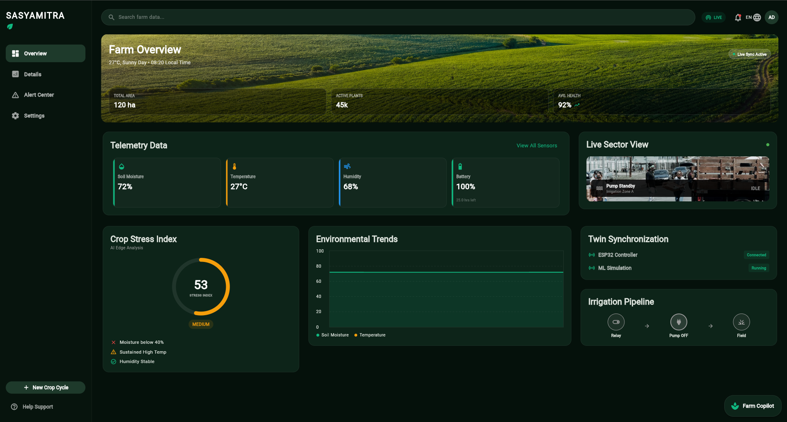
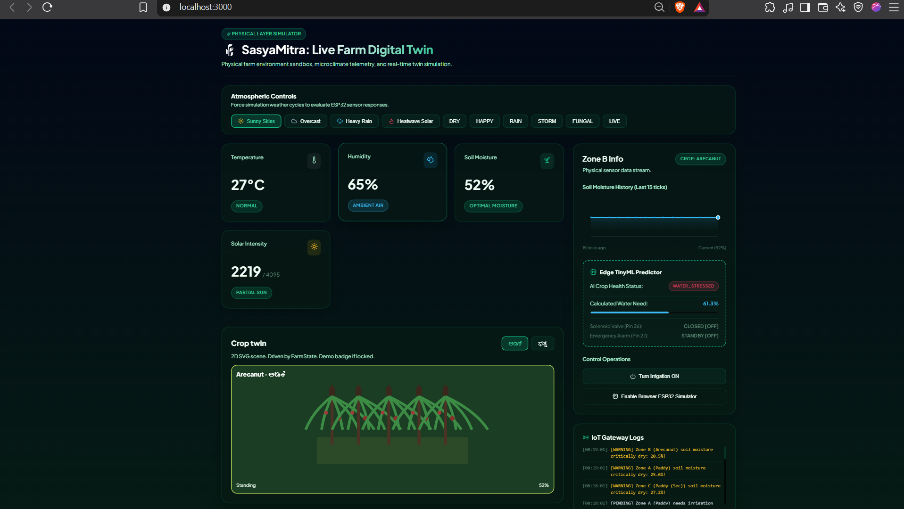
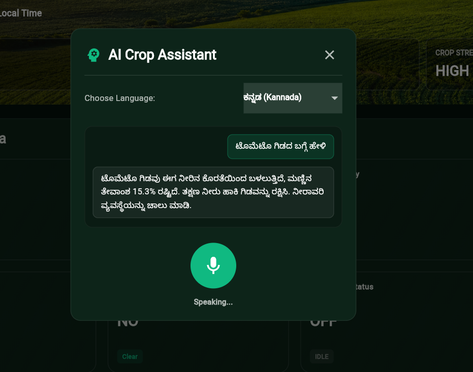
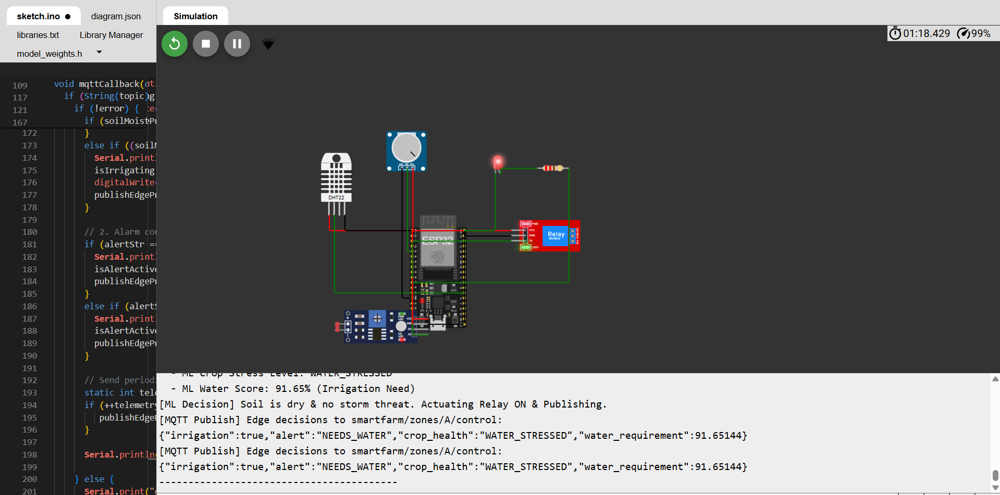
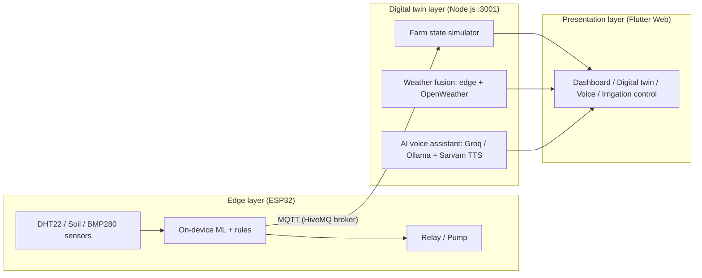

# SasyaMitra

**A friend for every crop: edge-intelligent farm monitoring that keeps working without the cloud.**

*Sasya* (crop) + *Mitra* (friend). A real-time digital twin, on-device ML on an ESP32, and a multilingual AI voice assistant (English, Kannada, Malayalam) for small farmers.


---

## Table of contents

1. [The problem](#-the-problem)
2. [What makes it different](#-what-makes-it-different)
3. [Screenshots](#-screenshots)
4. [Architecture](#-architecture)
5. [Features](#-features)
6. [Tech stack](#-tech-stack)
7. [Repository structure](#-repository-structure)
8. [Getting started](#-getting-started)
9. [Environment variables](#-environment-variables)
10. [API reference](#-api-reference)
11. [MQTT topics](#-mqtt-topics)
12. [Demo walkthrough](#-demo-walkthrough)
13. [Troubleshooting](#-troubleshooting)
14. [Limitations and honest scope](#-limitations-and-honest-scope)
15. [Roadmap](#-roadmap)
16. [Contributing](#-contributing)
17. [Acknowledgements](#-acknowledgements)

---

## The problem

**PS: Edge-Based Crop Monitoring with TinyML.**

Farmers lose crops to water wastage, fungal diseases that are noticed too late, and delays in reaching reliable farm services such as sprayers and labourers. In coastal Karnataka the monsoon brings heavy disease pressure on arecanut (koleroga) and paddy, and rural internet is unreliable, so cloud-only tools fail when they are needed most.

SasyaMitra uses an ESP32, sensors, edge ML and a Digital Twin to monitor soil conditions, optimise irrigation, and warn farmers when weather conditions favour fungal disease. Sensing, risk scoring and irrigation control run on the device, so essential monitoring continues even when the internet is down.

##  What makes it different

| Typical IoT farm | SasyaMitra |
|---|---|
| Sensor → Cloud → Decision → Actuator | Sensor → **Edge ML** → Actuator |
| Stops working without internet | Critical irrigation and storm decisions run on the device |
| English-only dashboards | Voice assistant in **English, Kannada and Malayalam** |
| Blind remote control | **Digital twin** mirrors the farm's state in real time |
| Generic weather | Edge pressure-trend prediction **fused** with OpenWeather when online |

##  Screenshots

| Live dashboard | Digital twin |
|---|---|
|  |  |
| Telemetry cards, crop stress index, trends, pump status, edge ML forecast | Interactive crop fields (Tomato, Rice, Wheat) with live readings and IoT gateway logs |

| Multilingual voice assistant | ESP32 on Wokwi |
|---|---|
|  |  |
| Kannada query about the tomato field, answered in Kannada | DHT22, soil input, relay and alert LED, with the edge decision published over MQTT |

##  Architecture



1. **Edge layer.** An ESP32 reads temperature and humidity (DHT22), soil moisture and air pressure (BMP280). A small neural network trained on 2,000 agriculture records (weights in `model_weights.h`) scores water need and crop stress, and the sketch drives the pump relay and alert output locally. A falling pressure trend is classified as `STABLE`, `RAIN_COMING` or `STORM_ALERT`, and irrigation is held back before a storm.
2. **Digital twin layer.** A Node.js server subscribes to the same MQTT broker, keeps a live virtual copy of each zone, blends the edge weather prediction with OpenWeather, serves the voice assistant, and exposes a REST API on port `3001`.
3. **Presentation layer.** A Flutter web dashboard shows live telemetry, trend charts, the digital twin, a weather forecast card, irrigation controls and the voice assistant.

##  Features

- **TinyML on the edge.** Predicts crop health and a water-requirement score on the ESP32, with no cloud round-trip for the decision.
- **Weather prediction (edge + cloud fusion).** Local pressure trends predict rain or storms offline. When internet is available, OpenWeather data is blended in. A "tomorrow" forecast card gives expected temperature, humidity, rain chance and irrigation advice.
- **Live digital twin.** Server-side simulation of zones A, B and C (Tomato, Rice, Wheat), synchronised over MQTT, with an interactive field view and an IoT gateway log.
- **Multilingual AI voice assistant.** Speak or type in English, Kannada (ಕನ್ನಡ) or Malayalam (മലയാളം). Groq LLaMA 3.3 70B answers online, Ollama (Qwen3 4B) is the local fallback, and Sarvam AI provides regional text-to-speech.
- **Smart irrigation control.** *Automated* mode lets the ESP32 drive the pump. *Semi-automated* mode asks the farmer to confirm before the pump starts, to prevent water waste. Manual control and an emergency alarm are available from the dashboard.
- **Real-time dashboard.** Soil moisture, temperature, humidity, battery, air pressure, rain, pump status, edge ML forecast, crop stress index and rolling trend charts.
- **No-hardware demo option.** Run the ESP32 on [Wokwi](https://wokwi.com), or use the **Enable Browser ESP32 Simulator** button on the digital twin page.

##  Tech stack

| Layer | Technologies |
|---|---|
| Edge device | ESP32, Arduino framework, DHT22, soil moisture sensor, BMP280, relay module |
| Edge ML | Small neural network trained on 2,000 agriculture records (`model_weights.h`), crop stress index |
| Communication | MQTT over the HiveMQ public broker (`mqtt://broker.hivemq.com`) |
| Backend | Node.js, Express.js |
| AI / LLM | Groq (LLaMA 3.3 70B), Ollama (Qwen3 4B) as local fallback, Sarvam AI text-to-speech |
| Weather | OpenWeather API + edge barometric-pressure prediction |
| Frontend | Flutter Web, Riverpod, fl_chart, go_router |
| Simulation | Wokwi (virtual ESP32 and sensors) |

##  Repository structure

```text
SasyaMitra/
├── DigitalTwin/
│   ├── backend/          # Node.js + Express digital twin, MQTT client, REST API (:3001)
│   └── wokwi/            # ESP32 firmware: sketch.ino, diagram.json, libraries.txt, model_weights.h
├── farmedge_monitor/     # Flutter web dashboard
├── screenshots/          # Images used in this README
└── README.md
```

> The folder names above are the ones used in the run commands below. If your checkout differs, adjust the `cd` paths.

##  Getting started

### Prerequisites

| Tool | Needed for | Notes |
|---|---|---|
| [Git](https://git-scm.com) | Cloning | |
| [Node.js](https://nodejs.org) + npm | Backend | Tested with Node v24 and npm 11 |
| [Flutter SDK](https://docs.flutter.dev/install) | Dashboard | Tested with Flutter 3.47 (stable). Only the **Flutter** and **Chrome** lines in `flutter doctor` need a green tick for the web dashboard. Android and Visual Studio warnings can be ignored |
| Google Chrome | Running the dashboard | |
| [Wokwi](https://wokwi.com) account (free) | ESP32 simulation | Browser based, no hardware needed |
| [Ollama](https://ollama.com) *(optional)* | Offline voice fallback | |

### Quick start (all commands)

Use **three terminals**. On Windows use Git Bash or PowerShell (both accept these paths).

```bash
# 0. Clone (once)
git clone https://github.com/ananya-asa/SasyaMitra.git
cd SasyaMitra

# ── Terminal 1: BACKEND (digital twin) ──────────────────────────
cd DigitalTwin/backend
npm install
# create the .env file first (see "Environment variables" below)
npm start                      # runs on http://localhost:3001

# ── Terminal 2: DASHBOARD (Flutter web) ─────────────────────────
cd farmedge_monitor            # from the repo root
flutter pub get
flutter run -d chrome

# ── Browser: ESP32 on Wokwi ─────────────────────────────────────
# See "3. ESP32 on Wokwi" below
```

Start the backend first, then the dashboard, then the ESP32. If the dashboard shows no data, refresh the page once the backend is running.

### 1. Backend (digital twin)

```bash
cd DigitalTwin/backend
npm install
```

Create a `.env` file in `DigitalTwin/backend/` (see [Environment variables](#-environment-variables)), then start the server:

```bash
npm start
```

A healthy start prints lines like these:

```text
[SIMULATOR] Successfully loaded 2000 records from dataset CSV.
[SIMULATOR] Successfully loaded neural network weights for JS predictions.
SMART AGRICULTURE DIGITAL TWIN SIMULATOR BACKEND RUNNING
Express HTTP Port: 3001
MQTT Server:       mqtt://broker.hivemq.com
MQTT Telemetry:    smartfarm/zones/:zoneId/telemetry
MQTT Controls:     smartfarm/zones/:zoneId/control
Simulation Loop:   Running every 60 seconds
MQTT Broker connected successfully at: mqtt://broker.hivemq.com
```

Check it in a browser: <http://localhost:3001/status?zone=A> should return JSON telemetry for zone A.

> The backend runs its own simulation loop every 60 seconds, so you can test the API and dashboard even without the ESP32 running.

### 2. Dashboard (Flutter web)

Open a **new terminal** and keep the backend running:

```bash
cd farmedge_monitor
flutter pub get
flutter run -d chrome
```

The first run downloads the Flutter web SDK and compiles the app, which takes a few minutes. Chrome then opens with the dashboard.

To make a production build:

```bash
flutter build web
```

### 3. ESP32 on Wokwi

1. Go to [wokwi.com](https://wokwi.com) and create a new **ESP32** project.
2. Copy the files from `DigitalTwin/wokwi/` into the project: `sketch.ino`, `diagram.json`, `libraries.txt` and `model_weights.h`.
3. Click **Start the simulation**.
4. Open the serial monitor. You should see lines like:

```text
[ML Decision] Soil is dry & no storm threat. Actuating Relay ON & Publishing.
[MQTT Publish] Edge decisions to smartfarm/zones/A/control:
{"irrigation":true,"alert":"NEEDS_WATER","crop_health":"WATER_STRESSED","water_requirement":91.65144}
```

The ESP32 publishes to the same public MQTT broker as the backend, so the digital twin and dashboard update automatically. Change the DHT22 readings and the soil-moisture input in the Wokwi diagram to see the decision change.

**No Wokwi?** Open the digital twin page in the dashboard and click **Enable Browser ESP32 Simulator**.

### 4. Optional: offline voice fallback with Ollama

```bash
ollama pull qwen3:4b
```

Keep Ollama running while you use the assistant offline. Quality is lower than the Groq model, and spoken output through Sarvam still needs internet.

##  Environment variables

Create `DigitalTwin/backend/.env`:

```env
GROQ_API_KEY=your_groq_key
SARVAM_API_KEY=your_sarvam_key
OPENWEATHER_API_KEY=your_openweather_key
```

| Variable | Used for | Where to get it |
|---|---|---|
| `GROQ_API_KEY` | Online voice assistant (LLaMA 3.3 70B) | [console.groq.com](https://console.groq.com) |
| `SARVAM_API_KEY` | Kannada and Malayalam text-to-speech | [sarvam.ai](https://www.sarvam.ai) |
| `OPENWEATHER_API_KEY` | Cloud weather fused with the edge prediction | [openweathermap.org](https://openweathermap.org/api) |

Create the file quickly:

```bash
# macOS, Linux or Git Bash
cd DigitalTwin/backend
cat > .env << 'EOF'
GROQ_API_KEY=your_groq_key
SARVAM_API_KEY=your_sarvam_key
OPENWEATHER_API_KEY=your_openweather_key
EOF
```

On Windows PowerShell, create the file in VS Code or Notepad and name it exactly `.env`.

> **Never commit `.env`.** Make sure it is listed in `.gitignore` (run `git status` and confirm it does not appear). Share keys with teammates privately.
>
> Without keys, sensor cards, trends and the digital twin still work. The voice assistant and the OpenWeather fusion need their keys.

##  API reference

Base URL: `http://localhost:3001`

| Method | Endpoint | Description |
|---|---|---|
| `GET` | `/status` | Live farm telemetry for a zone (for example `/status?zone=A`) |
| `GET` | `/api/voice-chat?query=...` | AI voice assistant query |
| `GET` | `/api/weather/predict-tomorrow?zone=A` | Edge ML + OpenWeather fused weather prediction |
| `POST` | `/api/trigger-mode` | Toggle irrigation mode (automated or semi-automated) |
| `POST` | `/api/zone/:id/irrigation` | Manual pump control |
| `POST` | `/api/zone/:id/alert` | Set or clear zone alerts |

Example:

```bash
curl "http://localhost:3001/status?zone=A"
curl "http://localhost:3001/api/weather/predict-tomorrow?zone=A"
```

##  MQTT topics

Broker: `mqtt://broker.hivemq.com` (public, for the prototype only)

| Topic | Direction | Purpose |
|---|---|---|
| `smartfarm/zones/:zoneId/telemetry` | Device → backend | Sensor readings per zone |
| `smartfarm/zones/:zoneId/control` | Device ↔ backend | Edge decisions and pump or alert commands per zone |

Example edge decision payload:

```json
{
  "irrigation": true,
  "alert": "NEEDS_WATER",
  "crop_health": "WATER_STRESSED",
  "water_requirement": 91.65144
}
```

##  Demo walkthrough

1. Start the backend, the dashboard and the Wokwi simulation (in that order).
2. **Dashboard.** Show live telemetry cards, the crop stress index and the trend chart.
3. **Edge decision.** In Wokwi, lower the soil-moisture input. The serial log shows the ML decision, the relay switches on, and the dashboard pump status changes.
4. **Storm logic.** Lower the simulated air pressure. The edge forecast moves towards `RAIN_COMING` or `STORM_ALERT` and irrigation is held back.
5. **Digital twin.** Open the interactive crop fields to see zones A (Tomato), B (Rice) and C (Wheat) and the IoT gateway logs.
6. **Voice assistant.** Choose Kannada or Malayalam and ask about a field, for example about the tomato crop.
7. **Irrigation modes.** Switch between automated and semi-automated irrigation.

##  Troubleshooting

| Problem | Fix |
|---|---|
| `flutter` is not recognized | Install Flutter, add its `bin` folder to PATH, then **close and reopen the terminal** |
| `flutter doctor` shows red for Android toolchain or Visual Studio | Ignore for the web dashboard. Only **Flutter** and **Chrome** need to be green |
| Dashboard opens but shows no data | Make sure the backend terminal is running, open <http://localhost:3001/status?zone=A> to confirm, then refresh Chrome |
| Port `3001` already in use | Stop the other process using it, or close the old backend terminal |
| `npm install` reports vulnerabilities | Safe to ignore for the demo. Do not run `npm audit fix --force`, as it can break dependencies |
| Backend prints `injected env (0)` | The `.env` file is missing or empty. Create it in `DigitalTwin/backend/` and restart |
| Voice assistant does not answer | Check `GROQ_API_KEY` and `SARVAM_API_KEY`, and that the backend was restarted after editing `.env` |
| Weather forecast looks edge-only | `OPENWEATHER_API_KEY` is missing or invalid |
| ESP32 data does not reach the dashboard | Confirm Wokwi shows the MQTT publish lines, and that the backend log shows the broker as connected. The public broker can be slow, so wait a moment |
| First `flutter run` is slow | Normal. The web SDK downloads once and the first compile takes a few minutes |

##  Limitations and honest scope

- The ESP32 runs on **Wokwi with simulated sensors**. It has not been tested on physical hardware or in the field.
- The edge model was trained on a **2,000-record agriculture dataset**. It has not been validated against field data.
- The backend simulation loop generates data every 60 seconds, so some dashboard values are simulated.
- The MQTT broker is **public** and the API has **no authentication**. This is acceptable for a prototype only. A real deployment needs a private broker with authentication and TLS, and secured pump commands.
- Weather fusion, the online language model and speech output need internet. The core irrigation and storm decisions do not.
- Kannada and Malayalam answer quality has not been tested with real farmers.
- Sensor fault detection is not implemented, and cheap soil sensors drift and corrode.

##  Roadmap

- 🌿 **Disease early warning *(in development)*.** Track how long humidity and temperature stay in a disease-favourable range, score risk as Low, Medium or High, and recommend preventive spray timing that takes rain into account. The first target is koleroga (fruit rot) of arecanut, with per-crop thresholds taken from published ICAR-CPCRI and KAU guidance and kept configurable. It is advice on timing only. The farmer or agriculture officer decides what to apply and how much.
- 🔍 Sensor trust score and fault detection
- 🔔 SMS alerts for farmers without smartphones
- 🤝 Pilot with a gram panchayat, including a verified local service-provider directory
- 📷 Computer-vision pest and disease detection
- 🛰️ Satellite weather integration
- 📱 Native Android and iOS apps
- 🚁 Drone-assisted field monitoring

##  Contributing

Work on a feature branch and keep `main` stable.

```bash
git checkout main
git pull origin main
git checkout -b your-feature-name

# ...make changes...
git add .
git commit -m "short description of the change"
git push -u origin your-feature-name
```

Then open a pull request into `main`. Pull `main` often to avoid conflicts, and never commit `.env` or `node_modules`.

##  Acknowledgements

[Groq](https://groq.com) · [Sarvam AI](https://www.sarvam.ai) · [OpenWeather](https://openweathermap.org) · [HiveMQ](https://www.hivemq.com) · [Wokwi](https://wokwi.com) · [Ollama](https://ollama.com) · [Flutter](https://flutter.dev)

---

*Made with ❤️ for farmers, using ESP32, MQTT, Node.js, Flutter and AI.*
